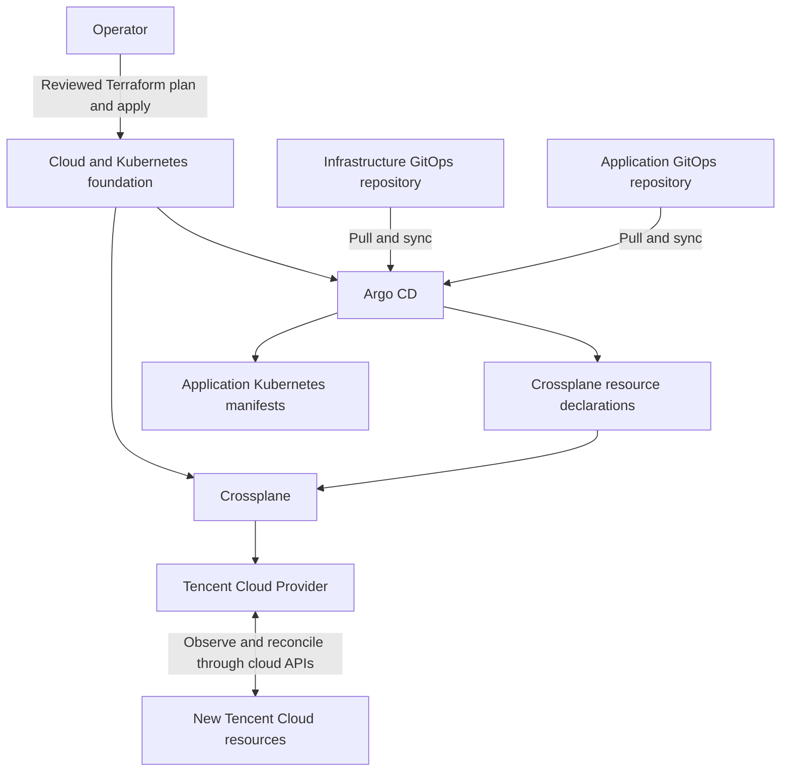

# Tencent Cloud Infrastructure GitOps

GitOps-managed Tencent Cloud infrastructure powered by Crossplane.

This repository is intended to hold declarative configuration for **new Tencent Cloud resources** managed by Crossplane. It complements the existing Terraform-managed Kubernetes foundation and application delivery repositories.

## Current Status

The repository currently contains documentation only. Crossplane installation, Provider configuration, Argo CD bootstrap, resource manifests, and automated validation have not been implemented here. The structure and workflow below describe the intended implementation.

## Architecture



Terraform creates the initial foundation through an operator-triggered workflow. Argo CD synchronizes Git declarations into Kubernetes. Crossplane and its Provider reconcile the corresponding external cloud resources.

Crossplane does not pull this Git repository itself. Argo CD performs that step. Resource reconciliation depends on Provider capabilities, cloud permissions, and the management policies configured for each resource.

### Related Repositories

| Repository | Responsibility |
| --- | --- |
| [tencentcloud-k8s](https://github.com/KaloSora/tencentcloud-k8s) | Terraform-managed cloud resources, self-hosted Kubernetes foundation, and platform bootstrap |
| [tencentcloud-k8s-app](https://github.com/KaloSora/tencentcloud-k8s-app) | Application source, build pipeline, and promotion logic |
| [tencentcloud-k8s-gitops](https://github.com/KaloSora/tencentcloud-k8s-gitops) | Application deployment declarations and application Argo CD configuration |
| [tencentcloud-infra-gitops](https://github.com/KaloSora/tencentcloud-infra-gitops) | Crossplane configuration and declarations for additional cloud infrastructure |

## Ownership Boundaries

Each cloud resource must have one active write manager.

- Existing CVMs, networking, storage, and other Terraform-owned resources remain under Terraform unless an explicit migration is planned.
- New resources declared here become Crossplane-owned after reconciliation is enabled.
- Crossplane installation and initial Argo CD bootstrap are intended to remain part of the Terraform foundation. This repository will own Provider configuration and subsequent infrastructure declarations.
- An existing Terraform-owned network may be referenced by a Crossplane-owned resource without transferring ownership of that network.
- Creating a resource object with an existing cloud ID can adopt a live resource. Imports require a separate review of ownership, desired configuration, and deletion behavior.

These boundaries apply to Kubernetes objects and Helm releases too: Terraform and Argo CD must not manage the same object or release concurrently.

## Planned Repository Structure

The following directories are proposed; they do not exist yet.

```text
.
├── README.md
├── argocd/
│   ├── projects/                  # Dedicated infrastructure AppProject
│   └── applications/              # Applications for platform and environment configuration
├── platform/
│   ├── providers/                 # Pinned Provider package declarations
│   ├── provider-configs/          # Authentication references; no credential values
│   └── compositions/              # Optional platform APIs, definitions, and compositions
├── environments/
│   ├── dev/                      # Initial resource pilot
│   ├── uat/
│   ├── preprod/
│   └── prod/
└── docs/                         # Resource ownership, onboarding, and recovery runbooks
```

Argo CD Applications should target specific configuration directories. Do not recursively synchronize the whole repository: examples and environment-specific resources must not be deployed unintentionally.

Environment directories organize declarations; they do not by themselves isolate Tencent Cloud accounts, permissions, or cloud resources. Kubernetes scope also depends on the selected Provider's CRDs.

## Bootstrap and First Resource

1. **Prepare the foundation.** Use the infrastructure repository to provision Kubernetes and install Argo CD and Crossplane. Keep an execution path outside this cluster for rebuilding the foundation.
2. **Select and pin versions.** Validate the Tencent Cloud Provider's compatibility with Crossplane and Kubernetes. Confirm that the required resource types, fields, and lifecycle operations are supported. Avoid floating `latest` versions.
3. **Provide cloud credentials outside Git.** Use a dedicated Tencent Cloud identity with permissions limited to the intended resources. Deliver credentials through an approved secret mechanism; commit only references to those credentials.
4. **Configure infrastructure GitOps access.** Create a dedicated Argo CD AppProject with explicit repository, destination, and resource permissions. The existing application `business-apps` project only permits Deployments and Services and is not suitable for Crossplane resources.
5. **Bootstrap platform configuration.** Synchronize Provider declarations first. Wait for Provider installation, controller health, and CRD availability before applying ProviderConfig or dependent resource objects. Establish explicit readiness gates between these stages.
6. **Start with an isolated development resource.** Use a new test COS bucket, outside the Terraform state backend and management-cluster backup storage. Add its validated declaration in a PR and review its permissions, lifecycle, and expected cost.
7. **Verify the complete lifecycle.** Check creation, a supported update, drift correction on an enforced mutable field, and controller restart recovery. Validate deletion or retention behavior using disposable resources before broader adoption.

No deployment commands are provided yet because the concrete versions, CRDs, paths, and resource manifests have not been selected and validated.

## Change Workflow

```text
Create branch
    → Add or update resource declarations
    → Validate against the selected Provider schemas
    → Review ownership, cloud impact, and lifecycle policies
    → Merge approved PR
    → Argo CD synchronizes Kubernetes objects
    → Crossplane Provider reconciles cloud resources
    → Verify actual readiness and application connectivity
```

Before enabling automatic sync, configure branch protection, required reviews, and appropriate validation checks. A merge may authorize billable cloud changes once automatic reconciliation is active.

Git merge and Argo CD synchronization are not sufficient evidence that a cloud resource is usable. Verify the relevant resource conditions, external resource ID, and actual cloud configuration. Dependent applications should wait for infrastructure readiness and required connection Secrets; commit order alone does not enforce readiness.

Console changes to fields enforced by Crossplane may be reverted during reconciliation. Make durable changes through Git. Infrastructure rollback requires reviewing the resulting cloud operation; reverting YAML is not a database restore and may not reverse an immutable-field change.

## State and Recovery

Crossplane does **not** require a separate COS Terraform state backend. Its durable management information is represented by Kubernetes objects, including resource specifications, status, identity annotations, and associated Secrets, persisted by the Kubernetes control plane.

The Tencent Cloud Provider uses Upjet, which handles Terraform-related runtime state internally. This does not require configuring another Terraform CLI backend for this repository.

The existing Terraform foundation continues using its own state backend. Crossplane recovery instead requires a tested backup and recovery process for the management cluster and relevant Kubernetes objects and Secrets.

Git stores desired declarations but does not contain all runtime identity information or credentials. Reapplying Git alone must not be assumed to safely reconnect every existing cloud resource. Document restore or re-adoption procedures using external resource IDs before relying on them.

If COS is used for management-cluster backups, provision that backup storage independently of the control plane being recovered. A dedicated backup bucket is backup storage, not a Crossplane Terraform state backend.

## Security and Deletion Controls

- Never commit cloud keys, kubeconfigs, plaintext or base64-encoded credential Secrets, private keys, or connection passwords.
- Separate application and infrastructure Argo CD permissions. Restrict access to cloud credentials and connection Secrets.
- Review Argo CD pruning, Application deletion propagation, Crossplane management policies, and deletion policies together. Removing a Kubernetes resource object can result in deletion of its external cloud resource.
- Select and test retention behavior for persistent data. Do not treat disabled Argo CD pruning as complete deletion protection.
- Confirm Provider support before relying on `managementPolicies`, including observe-only operation. Observation also needs a separate alerting design if drift notifications are required.
- Test existing-resource adoption separately; do not remove Terraform ownership until a reviewed handover and recovery procedure are ready.

## Implementation Roadmap

- [ ] Validate a pinned Crossplane and Tencent Cloud Provider combination.
- [ ] Implement dedicated credentials and infrastructure Argo CD access.
- [ ] Add staged bootstrap with Provider and CRD readiness checks.
- [ ] Manage a disposable development COS bucket through GitOps.
- [ ] Validate supported updates, drift correction, and deletion or retention behavior.
- [ ] Add manifest validation and required PR checks.
- [ ] Add reconciliation failure alerts and resource ownership records.
- [ ] Document and exercise management-cluster recovery.
- [ ] Introduce Compositions and custom platform APIs when reusable requirements emerge.

## References

- [Crossplane overview](https://docs.crossplane.io/latest/whats-crossplane/)
- [Crossplane managed resources and lifecycle policies](https://docs.crossplane.io/latest/managed-resources/managed-resources/)
- [Importing existing resources](https://docs.crossplane.io/latest/guides/import-existing-resources/)
- [Tencent Cloud Crossplane product overview](https://cloud.tencent.com/document/product/1763/105824)
- [Tencent Cloud Provider source](https://github.com/crossplane-contrib/provider-tencentcloud)
- [Upjet framework](https://github.com/crossplane/upjet)
- [Argo CD automated sync and pruning](https://argo-cd.readthedocs.io/en/stable/user-guide/auto_sync/)

References track upstream documentation. Select documentation matching the versions validated for this platform before implementing manifests.
